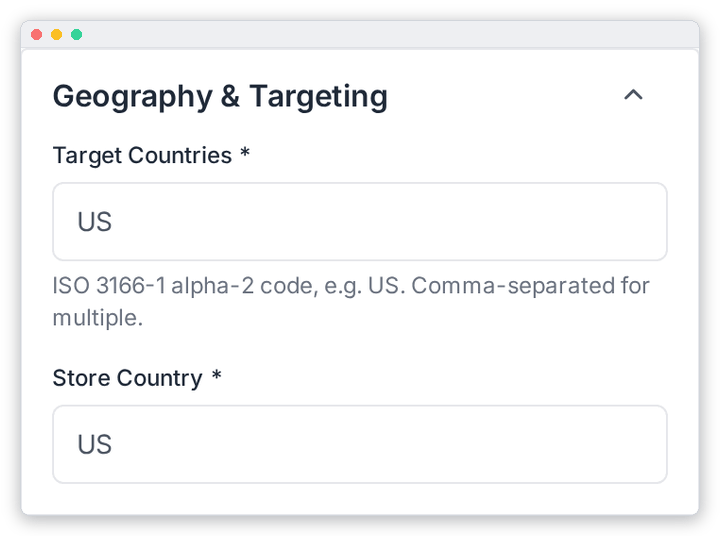

# Geography & Targeting

Say where you sell and where your store is based. These settings are in the **Geography & Targeting** panel (right column) of **OpenAI Feed › Configuration**. Remember to click **Save Settings** when you're done.

| Field | What it does |
|---|---|
| **Target Countries** \* | Where you sell, as two-letter ISO codes separated by commas: `US`, or `US, CA, GB`. Lower case is accepted and converted. |
| **Store Country** \* | The two-letter code of the country your store is based in, e.g. `US`. |

> [!IMPORTANT]
> ChatGPT shopping is currently available to **United States** shoppers only. OpenAI reads a standard feed as `US`, whatever you enter here, and only serves another country (India, for example) once OpenAI has approved that market for your integration. Leave **Target Countries** as `US` unless OpenAI has confirmed more markets for you.
>
> A product's currency or URL does not decide its market either: an `INR` price or a `.in` link does not make it visible to shoppers in India.

---

[← Return Policy](./return-policy.md) · [Product Filters →](./product-filters.md)
